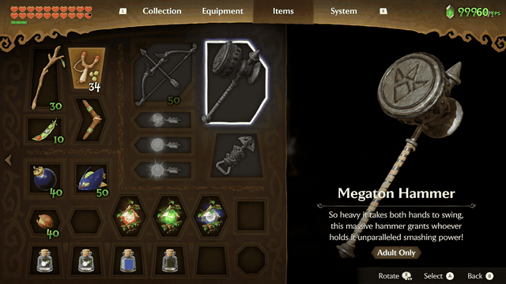

# 🎬 Video: Hookshot · Allow Games Edition + Allow Games Save Editor

**▶️ [Ver el video (1080p, 2:19)](media/allowgames-demo-1080p.mp4)**

Grabado por **AllGamersRD (Allow Games)** el 8 de noviembre de 2026 en PC, con **Hookshot · Allow Games Edition AG BETA v1.7**
y una partida editada con el **Allow Games Save Editor**. Imágenes de juego grabadas de su propia copia; el repositorio no
contiene ningún archivo del juego.

## Español

### Qué se ve
| Tiempo | Qué muestra |
|---|---|
| **0:00 – 1:05** | Jugando dentro del Gran Árbol Deku. El contador de arriba a la derecha marca **60 FPS fijos**: el port de Allow Games en un PC normal, sin tirones. Link tiene **20 corazones** desde el principio. |
| **1:02** | Abre un cofre (la brújula): el juego sigue funcionando normal con la partida editada. |
| **1:10** | **Objetos**: palos Deku 30, tirachinas, arco con 50 flechas, Megatón (martillo), gancho, boomerang, judías 10, bombas 40, bombchus 50, nueces Deku 40/40, las 3 magias (Fuego de Din, Viento de Farore, Amor de Nayru) y **4 botellas** (dos hadas, poción azul y una vacía). |
| **1:18** | **Equipo**: espadas Kokiri, Maestra y Biggoron, los 3 escudos, las túnicas, las **Botas Levitadoras**, la **Lente de la Verdad** y las máscaras. |
| **1:42** | **Colección**: Ocarina de las Hadas y **Ocarina del Tiempo**, Brazalete Goron, las bolsas grandes y lo demás. |
| **1:50 – fin** | De vuelta al juego con todo equipado. |

**La prueba de que es el editor:** Link es niño y está en la primera mazmorra, pero ya tiene objetos de adulto o del final
del juego (el Megatón, las Botas Levitadoras, la Espada de Biggoron, la Ocarina del Tiempo). Eso no se puede tener a esa
altura jugando normal.

### Notas honestas
- El video está grabado a **30 fps** (lo que permite el grabador); el juego iba a **60**, como marca su contador.
- El contador de rupias (999) queda tapado en parte por el de FPS en los menús.
- Probado en el port de PC. En emulador debería funcionar igual (es el mismo formato de partida), pero aún no está probado.

### Cómo hacerlo tú
1. Descarga `HookshotBuilder.zip` de la [última versión](https://github.com/AllGamersRD17/Hookshot-AllowGames/releases/latest) y
   construye el juego desde **tu propia copia** (ver el [README](../readme.md)).
2. Cierra el juego y arrastra tu `progress.sav` encima de `AllowGames-SaveEditor\AllowGames-SaveEditor.exe`.
   Guía completa: [tools/allowgames](../tools/allowgames/README.md).

## English

**What it shows:** 0:00–1:05 gameplay in the Great Deku Tree with the counter holding **60 FPS** and 20 hearts; 1:02 a chest
opens normally on the edited save; 1:10 the Items page (sticks 30, bow with 50 arrows, Megaton Hammer, hookshot, boomerang,
beans 10, bombs 40, bombchus 50, nuts 40, the three spells, 4 bottles); 1:18 Equipment (all swords and shields, tunics, Hover
Boots, Lens of Truth, masks); 1:42 Collection (Fairy Ocarina, Ocarina of Time, Goron Bracelet, bags).

**Why it proves the editor works:** child Link in the first dungeon already holds adult and late-game items (Megaton Hammer,
Hover Boots, Biggoron's Sword, Ocarina of Time), which normal play cannot give you there.

**Honest notes:** the recording is 30 fps (the game ran at 60, as its counter shows); tested on the PC port only.

Not affiliated with Nintendo. Code only: no game files, keys or saves in this repository.
